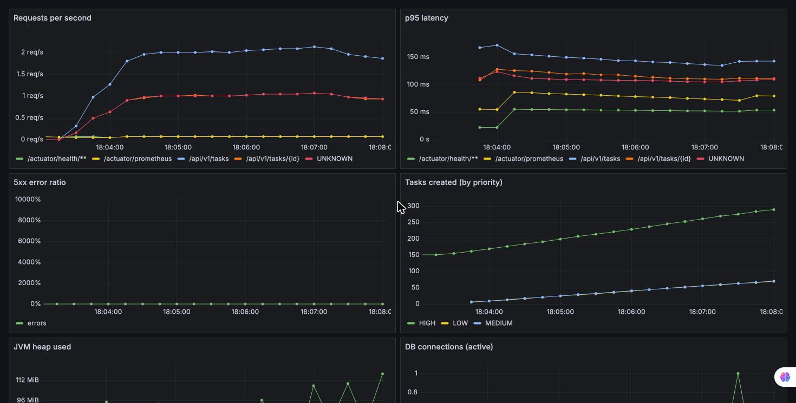

# WorkHub

[](https://github.com/alexandra10zam/WorkHub/actions/workflows/ci.yml)


A task management REST API built the way it would run in production: tested against a real database, packaged as a small non-root container, deployed to Kubernetes with Helm, and observable through Prometheus and Grafana.

Its cloud infrastructure lives in **[workhub-aws-terraform](https://github.com/alexandra10zam/workhub-aws-terraform)**.



## Highlights

- **Domain rules in code, not just CRUD.** Tasks follow an explicit workflow (`TODO → IN_PROGRESS → IN_REVIEW → COMPLETED`). An invalid move returns `409 Conflict`, and completed or cancelled tasks are read-only.
- **Safe concurrent updates** through JPA optimistic locking (`@Version`). A lost update becomes a `409` instead of silently overwriting data.
- **Schema owned by Flyway.** Hibernate only validates the schema (`ddl-auto: validate`), so the database is never changed behind your back.
- **RFC 7807 error responses** (`application/problem+json`) with per-field validation messages.
- **Security:** stateless HTTP Basic for the API. Health, metrics and docs stay public, so Kubernetes probes and Prometheus need no credentials.
- **Observability:** Micrometer metrics (latency histograms, business counters), a provisioned Grafana dashboard and Prometheus alert rules for downtime, error rate and p95 latency.
- **Tests:** 21 unit, web-layer and end-to-end tests. Integration tests run against real PostgreSQL via **Testcontainers**, with about 93% line coverage (JaCoCo).
- **CI/CD:** every push builds and tests the app, lints the Helm chart, deploys it to a throwaway **kind** Kubernetes cluster and smoke-tests it through the Service. Only then is the image published to GHCR.

## Architecture

```
            ┌───────────────┐      ┌──────────────┐
 client ──► │  WorkHub API  │ ───► │  PostgreSQL  │
            │ Spring Boot 3 │      │ (Flyway)     │
            └──────┬────────┘      └──────────────┘
                   │ /actuator/prometheus
            ┌──────▼───────┐      ┌──────────────┐
            │  Prometheus  │ ───► │   Grafana    │
            │  + alerts    │      │  dashboard   │
            └──────────────┘      └──────────────┘
```

| Layer | Tech |
|---|---|
| API | Java 21, Spring Boot 3.3, Spring Web, Bean Validation, springdoc OpenAPI |
| Persistence | Spring Data JPA, PostgreSQL 16, Flyway |
| Security | Spring Security (stateless HTTP Basic) |
| Observability | Actuator, Micrometer, Prometheus, Grafana |
| Testing | JUnit 5, Mockito, MockMvc, Testcontainers, JaCoCo |
| Delivery | Docker (multi-stage, layered, non-root), Helm, GitHub Actions, kind, GHCR |

## Run it locally

Requires Docker.

```bash
docker compose up --build
```

| Service | URL | Credentials |
|---|---|---|
| API docs (Swagger UI) | http://localhost:8080/swagger-ui.html | `admin` / `change-me` |
| Prometheus | http://localhost:9090 | none |
| Grafana | http://localhost:3000 | anonymous viewer, or `admin` / `admin` |

Ports already in use? Override them, for example `APP_PORT=18080 PG_PORT=15432 docker compose up --build`.

```bash
# create a task
curl -u admin:change-me -H 'Content-Type: application/json' \
  -d '{"title":"Ship v1","assignee":"alexandra","projectName":"WorkHub","priority":"HIGH"}' \
  http://localhost:8080/api/v1/tasks

# move it through the workflow
curl -u admin:change-me -X PUT -H 'Content-Type: application/json' \
  -d '{"status":"IN_PROGRESS"}' http://localhost:8080/api/v1/tasks/1/status

# filter and paginate
curl -u admin:change-me "http://localhost:8080/api/v1/tasks?status=IN_PROGRESS&assignee=alexandra&page=0&size=10"
```

## API

| Method | Path | Description |
|---|---|---|
| `POST` | `/api/v1/tasks` | Create a task (`201` + `Location` header) |
| `GET` | `/api/v1/tasks/{id}` | Get one task |
| `GET` | `/api/v1/tasks?status=&assignee=&projectName=` | Search with optional filters, paginated |
| `PATCH` | `/api/v1/tasks/{id}` | Partial update |
| `PUT` | `/api/v1/tasks/{id}/status` | Change status (validated against the workflow) |
| `DELETE` | `/api/v1/tasks/{id}` | Delete (`204`) |

## Deploy to Kubernetes

```bash
kubectl create secret generic workhub-db  --from-literal=password=<db-password>
kubectl create secret generic workhub-api --from-literal=username=admin --from-literal=password=<api-password>
kubectl apply -f k8s/dev/postgres.yaml      # dev only, use a managed DB in production

helm install workhub charts/workhub \
  --set autoscaling.enabled=true \
  --set serviceMonitor.enabled=true          # if kube-prometheus-stack is installed
```

The chart includes rolling updates with zero unavailable pods, startup, liveness and readiness probes on Actuator health groups, resource requests and limits, an optional HPA, Ingress and ServiceMonitor, a PodDisruptionBudget, a read-only root filesystem, and secrets taken only from existing Kubernetes Secrets.

## Tests

```bash
./mvnw verify          # needs Docker for Testcontainers; coverage report in target/site/jacoco
```

## Project layout

```
src/main/java/com/workhub
├── task/            entity, workflow enum, repository, service, controller, DTOs
├── common/          global exception handling (problem+json)
└── config/          security
src/main/resources/db/migration   Flyway SQL migrations
charts/workhub/                    Helm chart
k8s/dev/                           dev-only manifests (PostgreSQL)
monitoring/                        Prometheus config + alerts, Grafana provisioning + dashboard
.github/workflows/ci.yml           build → test → helm lint → kind deploy → publish image
```
